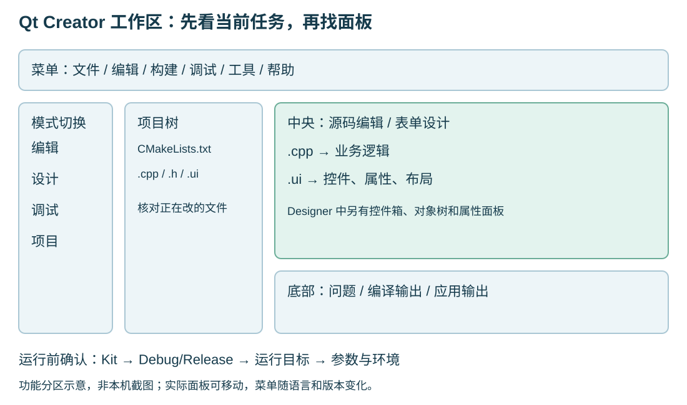
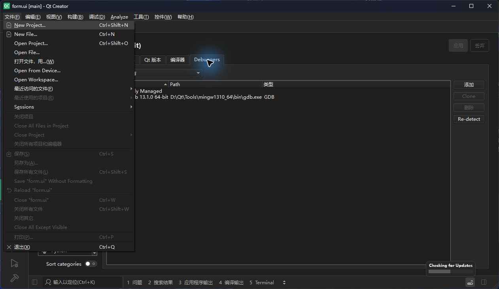

# 59 · Qt Creator 图形操作入门：认识界面与学习路线

## 本专题怎么跟着做

本机 Qt Creator 位于 `D:\Qt\Tools\QtCreator\bin\qtcreator.exe`，已核对版本为 **20.0.2**。课程项目继续使用 Qt **6.8.3 / MSVC 2022 x64**。Creator 自身“关于”里显示的 Qt 版本是 IDE 的构建环境，不等于你的项目实际选择的 SDK。

本专题用“操作入口 → 具体动作 → 应看到的结果 → 失败检查”的方式讲解。59～60 章先打开现有课程；61～64 章新建一个练习表单；65 章调试；66 章整理运行环境、问题排查与验收。可以在第 02 章之后提前学习，不必先读完全部图形 API。

菜单可能使用英文或中文，以下同时提供常见名称。小版本、插件和窗口大小可能改变位置；先按功能名称找菜单，快捷键只是辅助，不能靠记住某个图标的像素坐标。

## 一、打开正确的程序

1. 在文件管理器进入 `D:\Qt\Tools\QtCreator\bin`，双击 qtcreator.exe。
2. 等待主工作区，不要把“关于”对话框或独立 Designer 当成主界面。
3. 通过 Help/帮助中的 About Qt Creator/关于确认版本；看完关闭该对话框。
4. 本课程不要求登录云账号或连接 AI 插件；先完成本地 C++ 工程流程。

如果欢迎页有最近项目，可以点击已经确认路径的课程工程；第一次按第 60 章用“打开项目”选择 CMakeLists.txt。不要双击 Release 目录下的 exe，然后以为自己打开了工程。

## 二、工作区各部分做什么

| 区域 | 作用 | 初学者应该看什么 |
|---|---|---|
| 模式切换 | 编辑、设计、调试、项目、帮助等任务入口 | 当前是否在适合的模式 |
| 项目树 | 展示当前项目和参与构建的文件 | CMakeLists、cpp、h、ui 的位置 |
| 中央编辑区 | 编辑源码或设计表单 | 文件名、是否有未保存标记 |
| 项目/构建运行设置 | 选择 Kit、构建目录、参数和环境 | SDK、编译器、Debug/Release |
| 问题面板 Issues | 汇总错误和警告 | 第一条错误，而非只看最后“构建失败” |
| 编译输出 Compile Output | 原始编译和链接日志 | 实际构建命令、目标、出错文件 |
| 应用输出 Application Output | 程序日志与退出信息 | 运行哪个 exe、启动失败原因 |

图为功能分区示意，不是本机截图；实际停靠面板可移动。课程不会把示意图中的按钮位置当成固定操作坐标。

## 三、分清三个容易混淆的工具

Qt Creator 是集成开发环境；Qt Widgets Designer 用来拖拽设计 .ui 表单，可以集成在 Creator，也能独立运行；Qt Design Studio 面向另一条设计工作流，不是本课 Widgets 操作的前提。

打开 .cpp 通常进入代码编辑，打开 Widgets 的 .ui 通常进入表单设计。普通 QML 文本、.ui.qml 与 Widgets .ui 不是同一种文件，不能仅凭都能“画界面”就按同一套 Designer 操作。

## 四、先完成一个最小闭环

打开课程 → 选择 Kit → 构建 01_hello → 运行 → 修改标题 → 保存 → 再构建 → 再运行。每一步确认真实结果后再继续。能拖出按钮却没有运行过工程，还没有验证编译环境；能运行旧 exe，也不代表当前源码能成功构建。

建议建立学习记录：当前工程路径、Kit 名称、构建目录、运行目标、遇到的第一条错误。后面每次出现“还是旧窗口”，就按这五项核对。

参考：[Qt Creator 界面概览](https://doc.qt.io/qtcreator/creator-quick-tour.html)、[切换工作模式](https://doc.qt.io/qtcreator/creator-how-to-switch-between-modes.html)。

[下一步：配置 Kit](60.md)

## 配图逐项讲解

真实截图保持原始内容；图旁说明区分“当前默认状态”“课程目标值”和“故障反例”。示意图用于讲解关系，不代表已经完成的本机操作。可通过每幅图下的原图链接放大查看。

### 图 59-1 · 文件菜单：新建、打开项目与打开文件

**本机真实界面截图 · Qt Creator 20.0.2**

[打开原图查看细节](../assets/creator/file-menu.jpg)

- **看哪里**：左上方 File 菜单将 New Project、Open Project、Open File 分开列出。
- **怎样操作**：学习向导用 New Project；打开课程选择根 CMakeLists，单独看表单可 Open File。
- **结果与检查**：核对文件类型后再操作，不把打开一个 .ui 当成已经配置整个工程。

[返回目录](00-目录.md)
