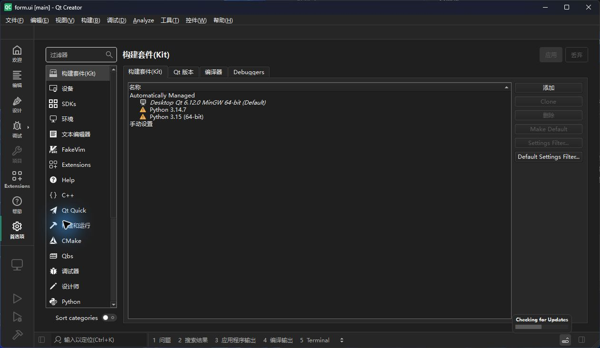
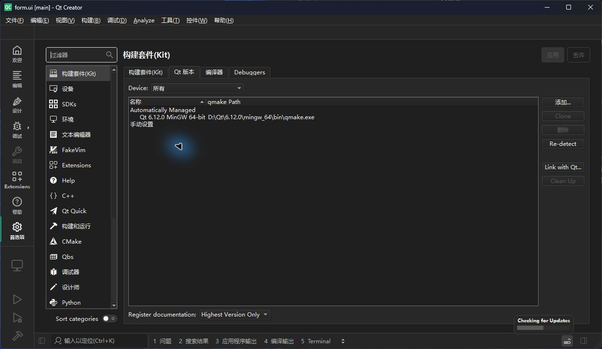
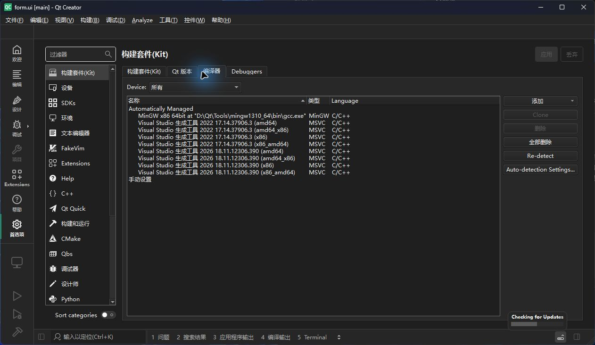
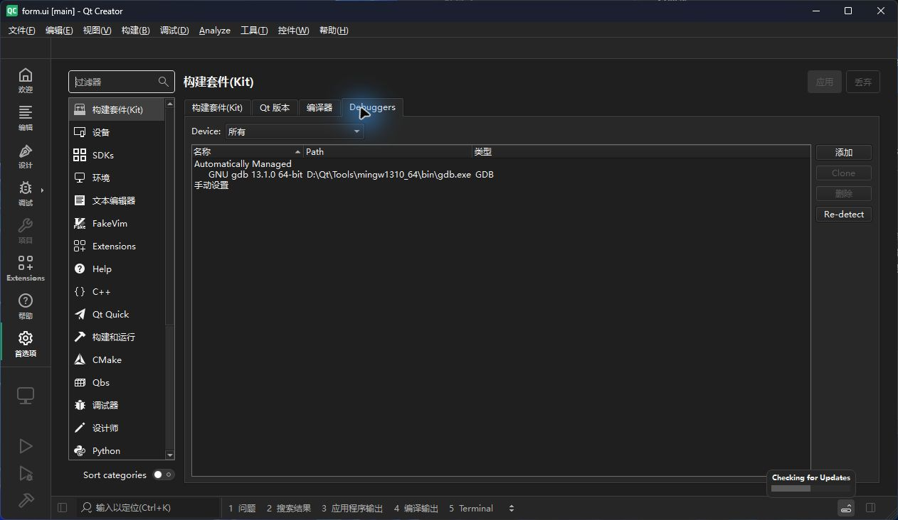
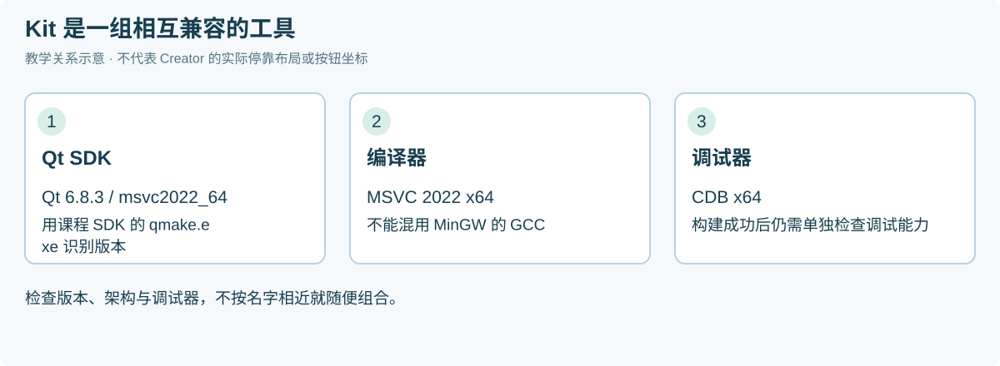

# 60 · 图形化配置 Kit：打开本地课程并构建运行

## 目标与准备

把现有 `E:\QT\QT` 工程放入 Creator，运行 01_hello。使用课程内的 SDK，不因 D:\Qt 中也有其他 Qt 版本就随意混用。Creator 是编辑器，Kit 才决定这次编译使用什么。

## 一、在设置中检查组成 Kit 的工具

进入 Preferences/首选项中的 Kits/构建套件；某些界面也会从 Tools/工具进入 Options/选项。使用设置页的类别或搜索框查找 Qt Versions、Compilers、Debuggers 和 CMake。

| 配置项 | 本课程应选择什么 | 检查要点 |
|---|---|---|
| Qt version | `E:\QT\QT\sdk\6.8.3\msvc2022_64\bin\qmake.exe` | 展示版本应为 6.8.3，不能只指向 bin 目录 |
| C++ compiler | Visual Studio 2022 / MSVC x64 | 不选择 MinGW 或其他架构 |
| CMake | 已安装且可运行的 CMake | 课程要求 3.21+ |
| Debugger | 与 MSVC 配套的 CDB x64 | 构建成功不等于调试器已装好 |
| Device | Desktop/桌面 | 本课不配置远程设备 |

若 Qt 未自动检测，点击 Add/添加并选择 qmake.exe。这里 qmake 用于识别 Qt 安装，不会把本课程 CMake 项目改成 qmake 工程。编译器不存在时，先检查本机 MSVC 安装，而不是在列表中随便选一个名字相近的工具。

若手工建立 Kit，给它起可辨认名字，如 `Course Qt 6.8.3 MSVC x64`。查看警告图标提示的实际问题；不要仅凭 Kit 能出现在下拉框就断言配置完整。不要修改已经用于其他项目的 Kit，优先新增课程自己的组合。

## 二、打开根工程

1. File/文件 → Open File or Project/打开文件或项目。
2. 选择 `E:\QT\QT\CMakeLists.txt`，不是 examples 中的 main.cpp。
3. 在 Configure Project/配置项目页选择上面的 MSVC Kit。
4. 构建目录设为 `E:\QT\QT\build-creator`，与脚本使用的 build 分开。
5. 若出现预设选择，检查 Qt 版本、生成器和目录，避免将脚本预设的 build 与个人 Creator 目录混成同一缓存。
6. 执行 Configure/配置，等待 CMake 结束，并查看配置输出。

看到 Qt6Config.cmake 找不到时，进入 Projects/项目 → Build Settings/构建设置，检查 CMAKE_PREFIX_PATH 是否指向 `E:/QT/QT/sdk/6.8.3/msvc2022_64`。它是 SDK 根目录，不是 bin，也不是 Creator 的安装目录。

## 三、选择构建配置与运行目标

先选 Debug，便于后面调试。项目有多个可执行目标；在运行目标选择器或 Run Settings/运行设置中明确选择 **01_hello**。不要将 ALL_BUILD、某个测试程序或 18_vulkan 当成第一个普通窗口目标。

点击 Build/构建后观察 Compile Output。成功后再点 Run/运行，窗口应出现课程问候文字。运行失败但构建成功，优先看 Application Output 中的 DLL、平台插件和实际 exe 路径，不回头重装所有工具。

如果出现缺少 Qt DLL，可以在当前运行配置的 Environment/环境中前置项目 Qt 的 bin，并按第 66 章设置插件路径。只调整当前项目运行配置，不把不同 Qt 的 bin 同时永久塞进系统 PATH。

## 四、用标题证明编译链确实工作

在项目树打开 examples/01_hello/main.cpp，将标题改为“我在 Creator 中运行 Qt”。保存文件，重新构建选定目标并运行。确认新标题后恢复课程标题或保留为自己的练习修改。

若仍旧标题，依次核对：是否保存、构建是否成功、是否选择正确 target、是否仍有旧进程、当前是 Debug 还是 Release、运行配置指向哪一个构建目录。不能只看绿色运行按钮存在。

## 验收

记录 Qt 根目录、MSVC 架构、构建目录、Debug 配置和运行目标。五项都能说清并成功改变标题后，再进入新建工程。Kit 的调试器缺失可以先记录，构建流程可继续，断点练习前必须补齐 CDB。

参考：[管理 Kit](https://doc.qt.io/qtcreator/creator-preferences-kits.html)、[打开项目](https://doc.qt.io/qtcreator/creator-project-opening.html)、[CMake 设置](https://doc.qt.io/qtcreator/creator-build-settings-cmake.html)。

## 配图逐项讲解

真实截图保持原始内容；图旁说明区分“当前默认状态”“课程目标值”和“故障反例”。示意图用于讲解关系，不代表已经完成的本机操作。可通过每幅图下的原图链接放大查看。

### 图 60-1 · Kit 总览：截图是当前状态，不是课程最终配置

**本机真实界面截图 · Qt Creator 20.0.2**

[打开原图查看细节](../assets/creator/kits-overview.jpg)

- **看哪里**：设置的构建套件页目前显示 Desktop Qt 6.12.0 MinGW。
- **怎样操作**：为课程另建 Qt 6.8.3 + MSVC 2022 x64 的组合，不修改其他项目正在用的套件。
- **结果与检查**：列表里有 Kit 不代表它适合课程；Qt、编译器和调试器都需兼容。

### 图 60-2 · Qt 版本页：qmake 路径决定识别哪一套 SDK

**本机真实界面截图 · Qt Creator 20.0.2**

[打开原图查看细节](../assets/creator/qt-versions.jpg)

- **看哪里**：截图自动检测项的 qmake 位于 D:/Qt/6.12.0/mingw_64。
- **怎样操作**：课程应额外添加 E:/QT/QT/sdk/6.8.3/msvc2022_64/bin/qmake.exe。
- **结果与检查**：添加后版本与路径应都可核对；不能把 Creator 自身版本当项目 Qt 版本。

### 图 60-3 · 编译器页：同一电脑可以有多套编译器

**本机真实界面截图 · Qt Creator 20.0.2**

[打开原图查看细节](../assets/creator/compilers.jpg)

- **看哪里**：列表里同时存在 MinGW、Visual Studio 2022 和 2026，以及不同架构。
- **怎样操作**：课程选择 MSVC 2022 的 x64/amd64 目标组合，不只按“Visual Studio”字样判断。
- **结果与检查**：目标架构、Qt ABI 与编译器匹配后，再进入 Kit 选择对应项。

### 图 60-4 · Debugger 页：当前只发现 GDB

**本机真实界面截图 · Qt Creator 20.0.2**

[打开原图查看细节](../assets/creator/debuggers.jpg)

- **看哪里**：本机页面当前显示 GNU gdb，没有 CDB。
- **怎样操作**：MSVC 课程调试应先安装并注册兼容的 CDB；保留 GDB 给已有 MinGW 工程。
- **结果与检查**：构建和普通运行可以先学，不能把它们通过当作 MSVC 断点调试已通过。

### 图 60-5 · Kit 是一组相互兼容的工具

**教学示意图 · 非实机截图**

[打开原图查看细节](../assets/creator/kit-chain.svg)

- **看哪里**：按图中 1、2、3 的关系理解该功能。
- **怎样操作**：用课程 SDK 的 qmake.exe 识别版本；不能混用 MinGW 的 GCC；构建成功后仍需单独检查调试能力。
- **结果与检查**：检查版本、架构与调试器，不按名字相近就随便组合。

### 图 60-6 · 保存、构建、运行是三个不同动作

**教学示意图 · 非实机截图**

[打开原图查看细节](../assets/creator/build-run-cycle.svg)

- **看哪里**：按图中 1、2、3 的关系理解该功能。
- **怎样操作**：确认没有未保存标记；编译输出成功才产生新的 exe；看新标题，证明运行的是新构建。
- **结果与检查**：编辑器能打开文件、编译成功和窗口出现，各自证明的事不同。

[返回目录](00-目录.md)
