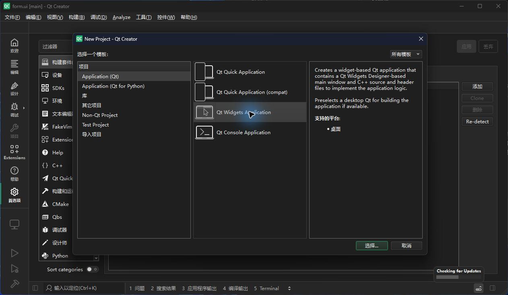
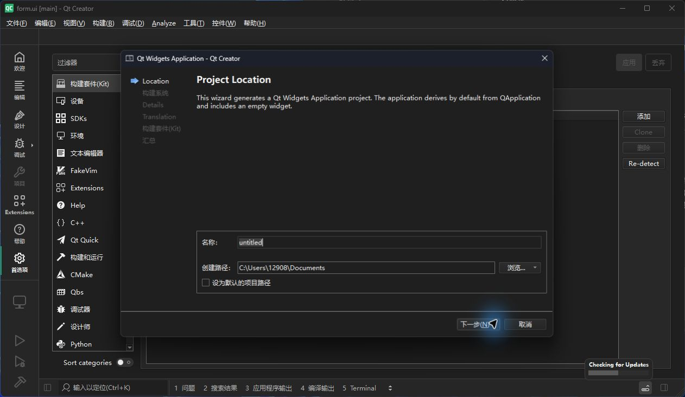
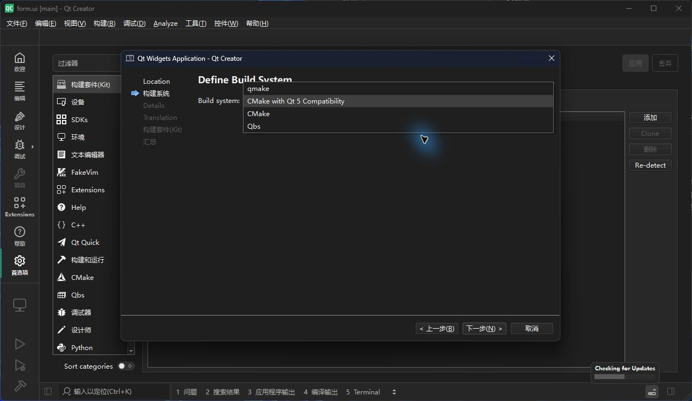
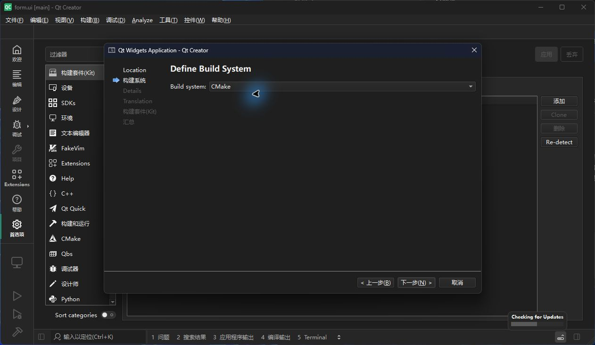
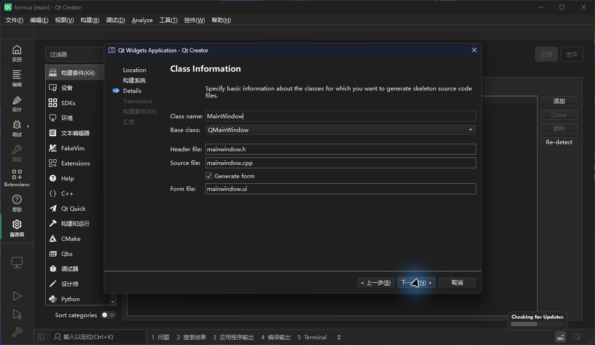
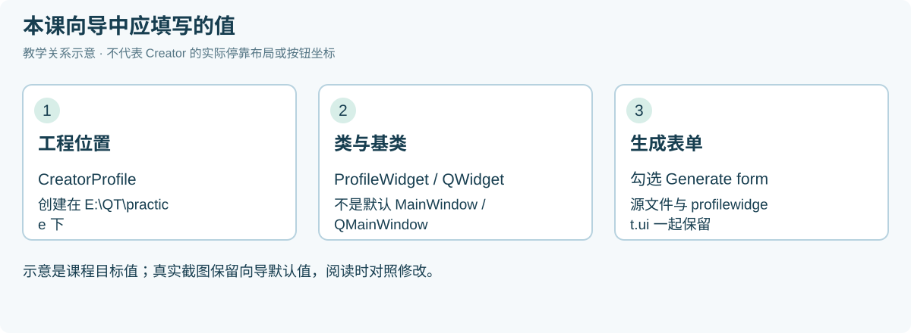

# 61 · 新建 Widgets 工程：用向导创建自己的练习窗口

## 为什么单独创建练习工程

本课程有多个目标和现成代码，适合阅读；学习 Designer 时还需要从空表单理解向导生成的文件。建议把个人练习放到 `E:\QT\practice\CreatorProfile`，不要放进 SDK，也不要创建在 build 或源码项目的某个生成目录里。

该路径是让你操作时使用的建议位置，本课程没有自动替你生成或覆盖该工程。下面统一使用 ProfileWidget 作为窗口类名，后面所有 ui 指针和槽函数名称都据此说明。

## 一、逐页完成向导

1. File/文件 → New Project/新建项目。
2. 在 Application (Qt)/应用程序中选择 Qt Widgets Application，点击 Choose/选择。
3. Name 填 CreatorProfile，Create in 填 `E:\QT\practice`；确认最终目录是 CreatorProfile。
4. Build System 选择 **CMake**；不要为了跟旧视频一致而改成 .pro。
5. Class name 填 **ProfileWidget**，Base class 选择 **QWidget**。
6. 勾选 Generate form/生成表单，确认表单文件名是 profilewidget.ui；头文件和实现文件通常会相应更新。
7. 翻译页按当前需要选择；初学可先保持默认，不为此中断核心练习。
8. 选择第 60 章的兼容 Kit，核对摘要再 Finish/完成。

若向导某页名称略有变化，仍检查最终生成的类、CMake 与 .ui。选成 Qt Quick Application 会得到不同文件结构；此时应重新建立正确练习，不把 QML 文件强行按本课 .ui 步骤拖拽。

## 二、每个生成文件有什么用

| 文件 | 你应该修改什么 | 不负责什么 |
|---|---|---|
| main.cpp | 应用创建、主窗口启动 | 不必把全部按钮业务塞进去 |
| profilewidget.h | 类声明、成员、槽函数声明 | 不是 Designer XML |
| profilewidget.cpp | 构造函数和业务处理 | 不编辑 uic 自动生成内容 |
| profilewidget.ui | 控件、布局、属性、表单连接 | 不自动替你实现数据库业务 |
| CMakeLists.txt | 依赖和源文件清单 | 不存用户任务数据 |

生成的 ui_profilewidget.h 位于构建目录，是 uic 的产物。你要保存的是 profilewidget.ui；下次构建会重新生成头文件，所以不要到 ui_*.h 手工加按钮。

## 三、第一次运行先不添加功能

构建并运行空窗口，确认配置正确。关闭后打开 .ui，在顶层窗口属性中改 windowTitle 为“个人学习计划”，保存、构建、再次运行。这个过程证明 Designer 修改确实进入编译结果。

注意 class name、objectName 和显示标题是三个概念：ProfileWidget 是 C++ 类，objectName 用于对象识别，windowTitle 是用户看到的文字。改 windowTitle 不会重命名类文件。

## 四、在代码编辑器里学会定位

在项目树中双击文件，在编辑区确认顶部文件名；使用 Find/查找找 setupUi，观察它出现在构造函数中。跳转声明/定义可从右键菜单选择，也可使用当前设置提供的快捷键。第一次不要做全工程替换，先了解当前文件查找与项目查找的范围区别。

如果需要新增 cpp，使用项目树 Add New/添加新文件，并检查 CMake 是否将它列入目标。项目树看得见文件不必然表示它已经参与编译；以构建配置和输出为准。

## 练习结果

完成一个独立工程，空窗口能运行，修改 .ui 的标题后新窗口能展示变化。记录五个源文件和构建目录。下一章只操作这个 ProfileWidget，不直接改动综合项目。

参考：[Qt Creator Widgets 向导教程](https://doc.qt.io/qtcreator/creator-writing-program.html)。

## 配图逐项讲解

真实截图保持原始内容；图旁说明区分“当前默认状态”“课程目标值”和“故障反例”。示意图用于讲解关系，不代表已经完成的本机操作。可通过每幅图下的原图链接放大查看。

### 图 61-1 · 向导模板：选择 Qt Widgets Application

**本机真实界面截图 · Qt Creator 20.0.2**

[打开原图查看细节](../assets/creator/widgets-template.jpg)

- **看哪里**：中央模板列表选中了 Qt Widgets Application，右侧说明 Widgets 与 C++。
- **怎样操作**：按本课创建 Widgets 工程，不选择上方 Qt Quick 模板。
- **结果与检查**：下一页应进入工程位置设置，后续会生成 .ui 与 C++ 文件。

### 图 61-2 · 工程位置：截图保留向导默认值

**本机真实界面截图 · Qt Creator 20.0.2**

[打开原图查看细节](../assets/creator/project-location.jpg)

- **看哪里**：名称默认 untitled，创建路径默认用户文档目录。
- **怎样操作**：将名称改为 CreatorProfile，创建路径改为 E:/QT/practice；这张图不是已完成填写的结果。
- **结果与检查**：最终目录应为 E:/QT/practice/CreatorProfile，不放进 SDK 或 build。

### 图 61-3 · 构建系统：注意默认兼容模式

**本机真实界面截图 · Qt Creator 20.0.2**

[打开原图查看细节](../assets/creator/build-system-options.jpg)

- **看哪里**：下拉列表同时出现 qmake、CMake with Qt 5 Compatibility、CMake、Qbs。
- **怎样操作**：本课只面向 Qt 6，选择纯 CMake；不要误以为所有带 CMake 的项完全一样。
- **结果与检查**：选择后回到页面核对当前显示值，再继续向导。

### 图 61-4 · 构建系统：确认选中的是 CMake

**本机真实界面截图 · Qt Creator 20.0.2**

[打开原图查看细节](../assets/creator/project-cmake.jpg)

- **看哪里**：当前 Build system 已显示 CMake。
- **怎样操作**：再按下一步进入 Class Information，不需要手工新建 .pro。
- **结果与检查**：后续项目应有 CMakeLists.txt，构建设置沿用兼容 Kit。

### 图 61-5 · 类信息：截图展示默认值，按课程改动

**本机真实界面截图 · Qt Creator 20.0.2**

[打开原图查看细节](../assets/creator/project-class.jpg)

- **看哪里**：默认是 MainWindow/QMainWindow，并勾选 Generate form。
- **怎样操作**：课程改成 ProfileWidget/QWidget，保留生成表单，再检查 .h、.cpp、.ui 文件名。
- **结果与检查**：类、文件名和 objectName 是不同概念；不要只改显示标题来重命名类。

### 图 61-6 · 本课向导中应填写的值

**教学示意图 · 非实机截图**

[打开原图查看细节](../assets/creator/wizard-values.svg)

- **看哪里**：按图中 1、2、3 的关系理解该功能。
- **怎样操作**：创建在 E:\QT\practice 下；不是默认 MainWindow / QMainWindow；源文件与 profilewidget.ui 一起保留。
- **结果与检查**：示意是课程目标值；真实截图保留向导默认值，阅读时对照修改。

[返回目录](00-目录.md)
