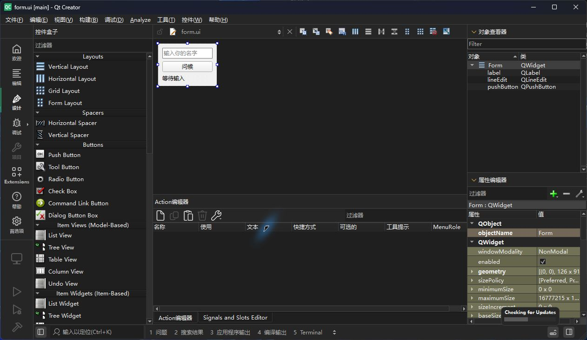
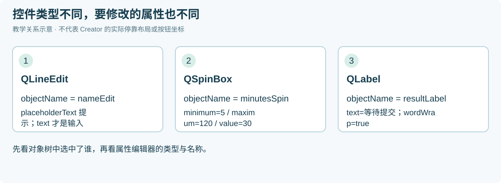
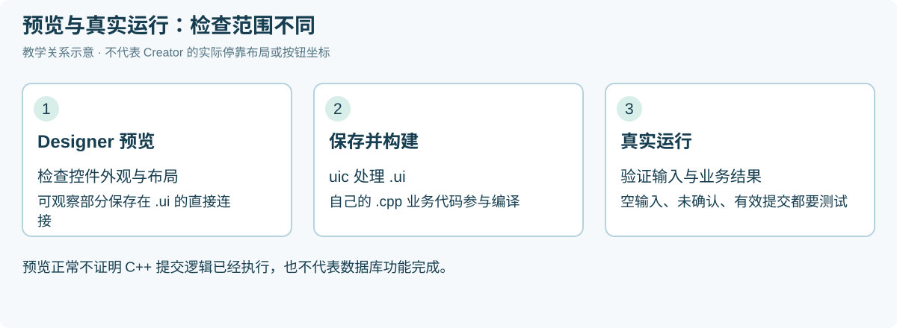

# 62 · Designer 拖拽入门：控件、属性与 objectName

## 一、进入表单设计界面

在第 61 章工程中双击 profilewidget.ui。通常自动进入 Design/设计模式。若看到 XML，检查是否使用了文本编辑器打开；通过文件的 Open With/打开方式选择合适的表单编辑器。不要因为暂时看不到画布就把 .ui 改名为 .cpp。

Designer 中至少认识四块：Widget Box/控件箱、中央画布、Object Inspector/对象查看器、Property Editor/属性编辑器。属性面板总是在编辑当前选中的对象；先看 objectName 或对象树选择，再改值。

## 二、按表格放入控件

先把以下控件拖到画布，暂时只需大致分区；下一章用布局规范尺寸。选择 QLabel 时可从控件箱搜索，也可在相应类别中拖出。

| 类型 | objectName | text 或初始值 | 关键属性 |
|---|---|---|---|
| QLabel | nameLabel | 姓名 | buddy 后续指向 nameEdit |
| QLineEdit | nameEdit | 保持输入内容为空 | placeholderText=请输入姓名，maxLength=40 |
| QLabel | minutesLabel | 每天分钟数 | buddy 指向 minutesSpin |
| QSpinBox | minutesSpin | value=30 | minimum=5，maximum=120 |
| QCheckBox | agreeCheck | 确认学习计划 | checked=false |
| QPushButton | submitButton | 生成计划 | 不设置 checkable |
| QPushButton | clearButton | 清空文字 | 后面连接 clear 槽 |
| QLabel | resultLabel | 等待提交 | wordWrap=true |

objectName 要在英文状态输入，不加空格。显示文字可以是中文，代码里访问的是 ui->nameEdit，而不是 ui->请输入姓名。修改 objectName 后，旧 C++ 名称不会自动保证全部同步；构建前检查引用。

## 三、怎样修改属性而不选错对象

1. 点击画布中的输入框；若重叠或很小，在对象树直接选 nameEdit。
2. 在属性面板确认当前对象为 QLineEdit/nameEdit。
3. 搜索 placeholderText，填提示文字，再搜索 maxLength 填 40。
4. 点击空白背景或对象树顶层，才能修改整个表单的 windowTitle。
5. 如果改错，用撤销恢复；不要通过删除整个表单来解决一个属性错误。

text 与 placeholderText 不同：前者是实际输入，后者只在内容为空时提示。QLabel 的 text 是显示内容，QSpinBox 的 value 是数值；不能对所有控件都找同一个“文字”属性。

## 四、预览和真实运行各验证什么

使用 Form/表单的 Preview/预览，部分版本入口可能在设计菜单。预览检查样式、排版和部分 .ui 连接，不会执行你在 ProfileWidget.cpp 中编写的业务处理。自定义按钮逻辑必须保存并构建真实程序验证。

现在先预览一次，确认姓名框可输入、分钟范围限制正确、结果标签能换行。关闭预览后保存 .ui。不要把运行窗口的改动当作 Designer 源文件已经修改，两者是独立状态。

## 五、操作验收

逐个在对象树点选并读出类型、名称与关键属性。故意把 placeholderText 改成 text，预览比较，再恢复。确认顶层对象只有预期窗口，按钮没有意外嵌套到某个错误父控件中。

下一章会解决缩放后重叠问题；本章不要求通过手工拖坐标获得最终布局。

参考：[Creator 中设计 Widgets](https://doc.qt.io/qtcreator/creator-using-qt-designer.html)、[Designer 手册](https://doc.qt.io/qt-6.8/qtdesigner-manual.html)。

## 配图逐项讲解

真实截图保持原始内容；图旁说明区分“当前默认状态”“课程目标值”和“故障反例”。示意图用于讲解关系，不代表已经完成的本机操作。可通过每幅图下的原图链接放大查看。

### 图 62-1 · Designer 全景：四块区域协同工作

**本机真实界面截图 · Qt Creator 20.0.2**

[打开原图查看细节](../assets/creator/designer-overview.jpg)

- **看哪里**：左侧控件箱、中央表单、右上对象树、右下属性面板同时可见。
- **怎样操作**：先在对象树或画布选中对象，再修改属性；左侧设计模式表明正在操作 .ui。
- **结果与检查**：下方 Action 编辑器不等于按钮 clicked 的业务实现，不要把不同编辑面板混淆。

### 图 62-2 · 对象与属性：先确认选中了 lineEdit

**本机真实界面截图 · Qt Creator 20.0.2**

[打开原图查看细节](../assets/creator/designer-properties.jpg)

- **看哪里**：对象树高亮 lineEdit，属性面板标题显示 lineEdit: QLineEdit。
- **怎样操作**：修改 objectName、placeholderText 等时先检查这里的类型与名称，必要时用属性过滤框查找。
- **结果与检查**：属性改在目标输入框上，而不是误改顶层 Form 或旁边的 label。

### 图 62-3 · 控件类型不同，要修改的属性也不同

**教学示意图 · 非实机截图**

[打开原图查看细节](../assets/creator/control-properties.svg)

- **看哪里**：按图中 1、2、3 的关系理解该功能。
- **怎样操作**：placeholderText 提示；text 才是输入；minimum=5 / maximum=120 / value=30；text=等待提交；wordWrap=true。
- **结果与检查**：先看对象树中选中了谁，再看属性编辑器的类型与名称。

### 图 62-4 · 预览与真实运行：检查范围不同

**教学示意图 · 非实机截图**

[打开原图查看细节](../assets/creator/preview-versus-run.svg)

- **看哪里**：按图中 1、2、3 的关系理解该功能。
- **怎样操作**：可观察部分保存在 .ui 的直接连接；自己的 .cpp 业务代码参与编译；空输入、未确认、有效提交都要测试。
- **结果与检查**：预览正常不证明 C++ 提交逻辑已经执行，也不代表数据库功能完成。

[返回目录](00-目录.md)
