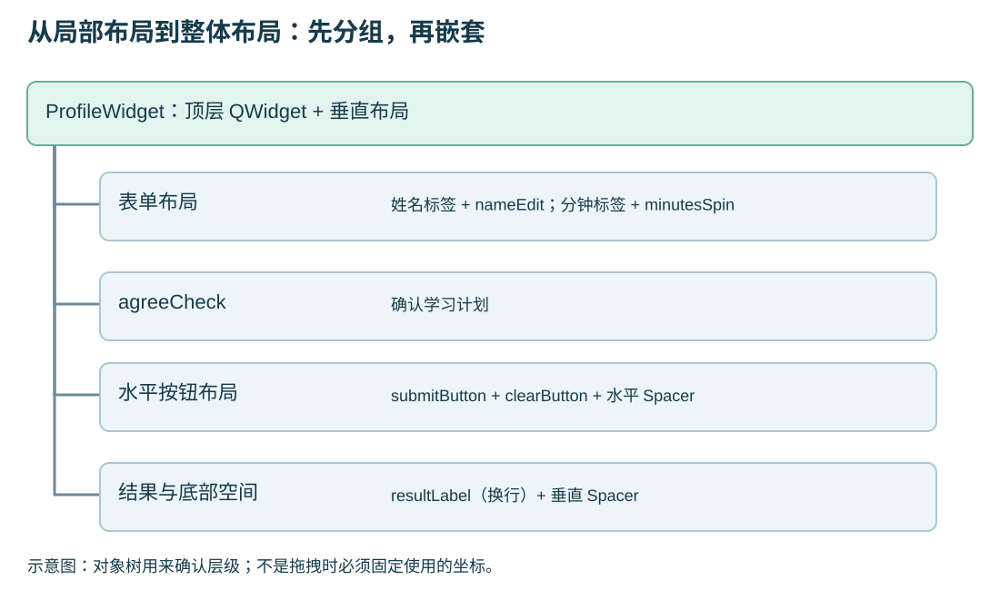
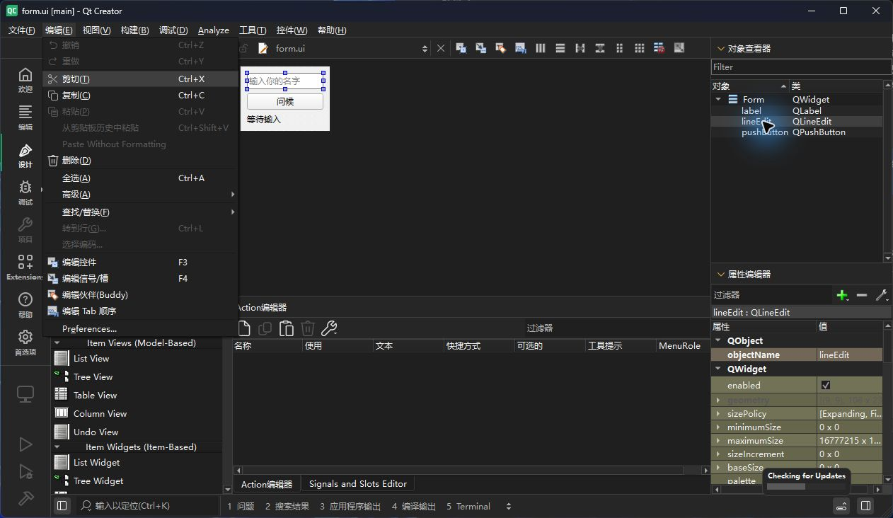
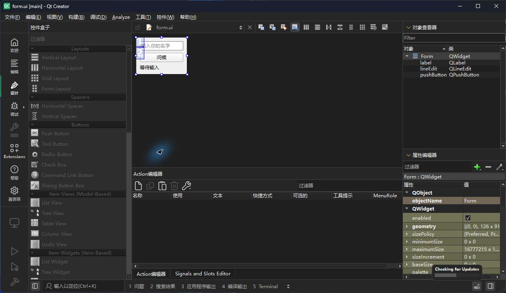
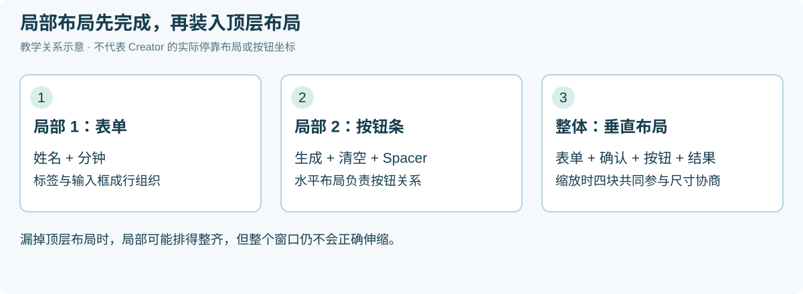
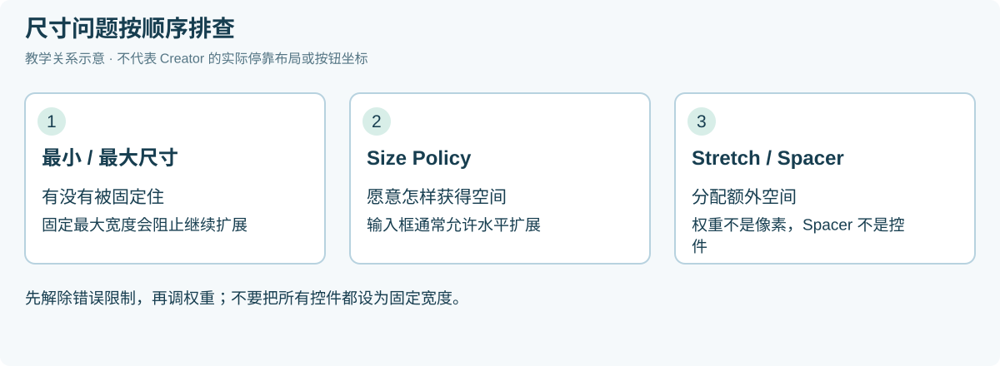
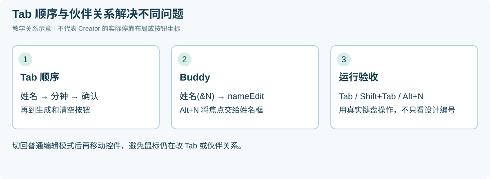

# 63 · Designer 布局实操：嵌套、拉伸、Tab 与伙伴关系

## 一、先确定期望的结构

上面两行是姓名和分钟输入，中间是确认框，下面是按钮条和结果。用布局表达这种关系，让窗口大小变化时由 Qt 重新分配空间，而不是记住每个控件的绝对坐标。

这是目标布局树示意，不是必须照抄的 XML。初次选择错误时先在对象树确认当前层级，不要连续点击多种布局按钮。

## 二、先做局部布局，再做整体布局

1. 选中 nameLabel、nameEdit、minutesLabel、minutesSpin。在画布用多选，或按住 Ctrl 在对象树逐项选择。
2. 从右键布局菜单选择 Lay Out in a Form Layout/表单布局；确认标签与输入框一一对应。若自动排列不合意，在布局中调整行，而不是改变输入框的父对象碰碰运气。
3. 选择 submitButton 与 clearButton，应用水平布局；可放一个 Horizontal Spacer 将按钮推向一侧。
4. 选择顶层 QWidget，在空白背景右键应用垂直布局，将表单、确认框、按钮布局、结果区纳入整体。
5. 在对象树检查局部布局是否成为顶层布局的一部分，窗口缩放时整块结构应一起变化。

如果出现“已安装布局”或控件不能自由移动，可能已经处于布局中。Break Layout/打破布局是移除当前层级的布局约束，不是删除控件；仅当你确实要重组这个局部区域时使用，然后重新布局。不要把“拖不动”当成应用故障。

## 三、用属性表达尺寸需求

输入框通常允许水平伸展；按钮可保持建议尺寸；结果区应允许换行。先检查 minimumSize、maximumSize、sizePolicy，再检查布局 stretch。把所有控件设成固定宽度会使新布局仍然表现很差。

布局属性中的 spacing 管控件间距，contentsMargins 管内部留白，stretch 决定额外空间的相对分配。这些不是同一个参数。设置 stretch 前在对象树确认该布局实际包含几个 item，位置顺序与权重列表对应。

本表单不需要强制 resultLabel 吃掉全部高度；可在底部增加垂直 spacer，让上方表单集中排列。若将来换成大表格，则可以让结果区承担主要拉伸。

## 四、图形化设置 Tab 顺序与 buddy

切换到 Edit Tab Order/编辑 Tab 顺序模式，按姓名 → 分钟 → 确认 → 生成 → 清空的顺序点击。回到普通编辑模式，再预览或运行，用真实 Tab 和 Shift+Tab 验证，而不是只看编号好看。

给 nameLabel.text 设置“姓名(&N)”，再使用 Edit Buddies/编辑伙伴关系或对应属性，将标签关联到 nameEdit。运行时 Alt+N 应将焦点放到姓名框。伙伴关系是键盘操作帮助，不是自动复制标签文字到输入框。

不同模式下鼠标动作含义不同：普通编辑选控件，信号槽模式画连接，Tab 模式改顺序，buddy 模式连伙伴。完成一种任务后切回普通模式，避免以为拖控件却在画连接。

## 五、验收与常见修复

将窗口横向拉宽、缩窄，检查姓名框扩展、文字不重叠；用较长中文姓名和较大字体观察。若没有高 DPI 环境，记录未实测，不用一次普通预览推断所有缩放正常。

常见错误是漏给顶层加布局、选中了错误父容器、某个固定最大尺寸阻止伸展。修复顺序是对象树 → 顶层布局 → 局部布局 → 尺寸约束，最后才考虑重建局部布局。

参考：[Designer 布局操作](https://doc.qt.io/qt-6.8/designer-layouts.html)。

## 配图逐项讲解

真实截图保持原始内容；图旁说明区分“当前默认状态”“课程目标值”和“故障反例”。示意图用于讲解关系，不代表已经完成的本机操作。可通过每幅图下的原图链接放大查看。

### 图 63-1 · 设计模式切换：同样鼠标动作含义不同

**本机真实界面截图 · Qt Creator 20.0.2**

[打开原图查看细节](../assets/creator/designer-modes-menu.jpg)

- **看哪里**：编辑菜单里列出编辑控件、编辑信号/槽、编辑伙伴、编辑 Tab 顺序。
- **怎样操作**：按当前任务选模式；移动控件前切回编辑控件，常见默认键是 F3。
- **结果与检查**：F4 在这里进入信号槽模式；以实际菜单和焦点上下文为准。

### 图 63-2 · Tab 顺序模式：画布显示焦点编号

**本机真实界面截图 · Qt Creator 20.0.2**

[打开原图查看细节](../assets/creator/designer-tab-order.jpg)

- **看哪里**：表单输入框和按钮上出现编号提示；左侧控件箱暂不可拖入。
- **怎样操作**：按期望焦点顺序点选控件，结束后切回普通模式再用键盘验证。
- **结果与检查**：这张图展示课程原小表单，ProfileWidget 应按姓名、分钟、确认、按钮排序。

### 图 63-3 · 局部布局先完成，再装入顶层布局

**教学示意图 · 非实机截图**

[打开原图查看细节](../assets/creator/nested-layout.svg)

- **看哪里**：按图中 1、2、3 的关系理解该功能。
- **怎样操作**：标签与输入框成行组织；水平布局负责按钮关系；缩放时四块共同参与尺寸协商。
- **结果与检查**：漏掉顶层布局时，局部可能排得整齐，但整个窗口仍不会正确伸缩。

### 图 63-4 · 尺寸问题按顺序排查

**教学示意图 · 非实机截图**

[打开原图查看细节](../assets/creator/size-policy.svg)

- **看哪里**：按图中 1、2、3 的关系理解该功能。
- **怎样操作**：固定最大宽度会阻止继续扩展；输入框通常允许水平扩展；权重不是像素，Spacer 不是控件。
- **结果与检查**：先解除错误限制，再调权重；不要把所有控件都设为固定宽度。

### 图 63-5 · Tab 顺序与伙伴关系解决不同问题

**教学示意图 · 非实机截图**

[打开原图查看细节](../assets/creator/tab-buddy.svg)

- **看哪里**：按图中 1、2、3 的关系理解该功能。
- **怎样操作**：再到生成和清空按钮；Alt+N 将焦点交给姓名框；用真实键盘操作，不只看设计编号。
- **结果与检查**：切回普通编辑模式后再移动控件，避免鼠标仍在改 Tab 或伙伴关系。

[返回目录](00-目录.md)
