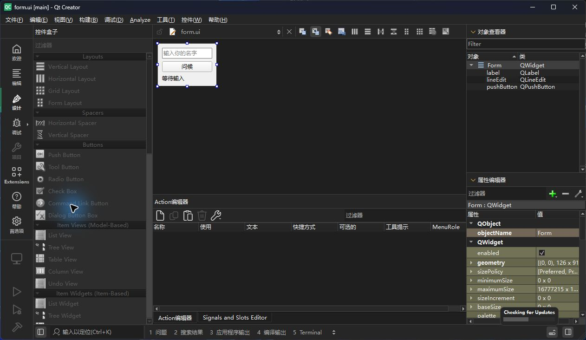
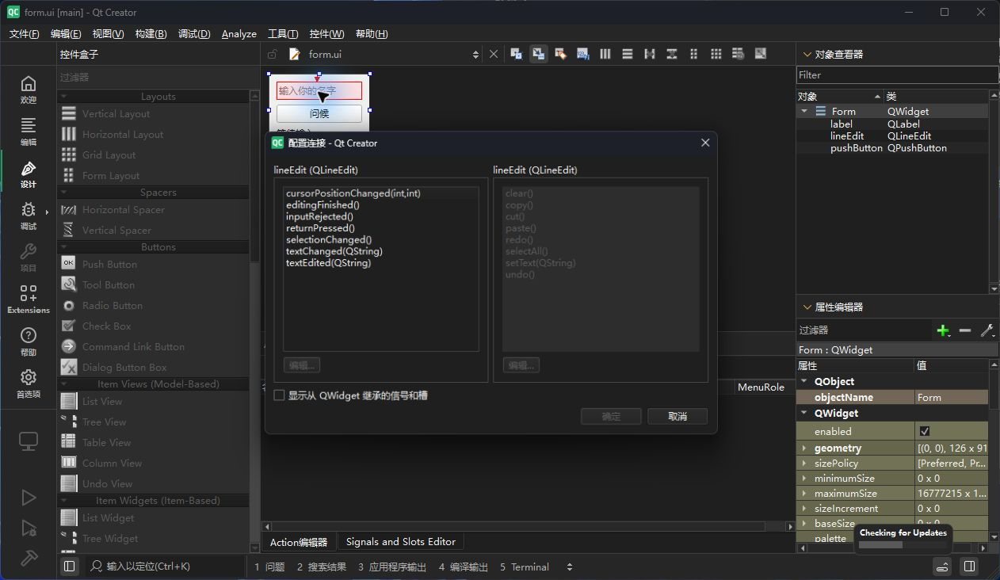
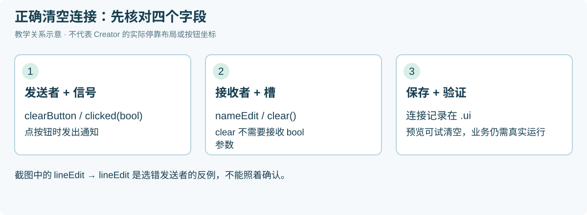
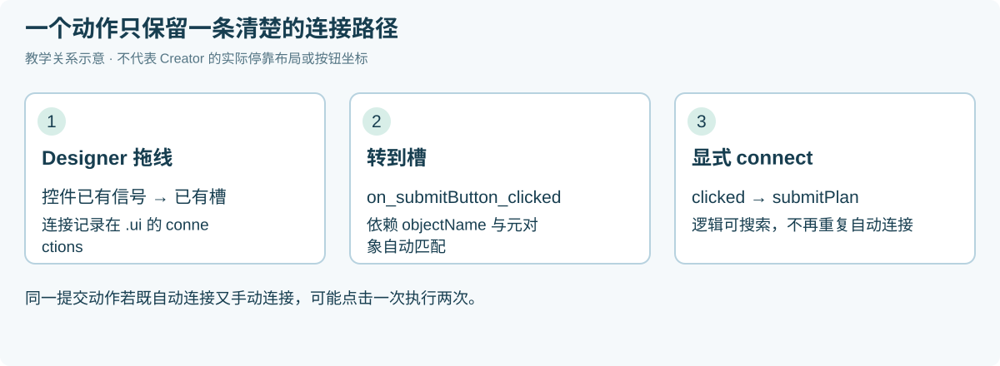

# 64 · 图形化连接信号槽：拖线、转到槽与显式 connect

## 一、三种连接方式分别适合什么

| 方式 | 连接保存在哪里 | 适合的场景 | 常见问题 |
|---|---|---|---|
| Designer 信号槽编辑器 | .ui 的 connections | 控件已有信号接已有槽 | 选错对象或参数不兼容 |
| Go to Slot/转到槽 | 自己的 C++ 窗口类 | 快速建立某个事件处理函数 | 改 objectName 后自动命名槽不匹配 |
| 显式 connect | 自己维护的 .cpp | 明确可搜索的连接与业务逻辑 | 与自动连接重复，点击执行两次 |

拖线不能凭空实现复杂业务。连接 clicked 到 clear 可以清空文字；生成带验证的学习计划，仍需 C++ 读取输入、检查规则并更新结果。

## 二、不写业务代码的清空文字连接

1. 打开 profilewidget.ui，进入 Edit Signals/Slots/编辑信号槽模式。Designer 常用 F4，但若快捷键被修改，使用菜单或工具提示确认。
2. 从 clearButton 拖向 nameEdit，打开连接选择窗口。
3. 发送端选择 clicked(bool)，接收端选择 clear()。若列表过滤过严，检查“显示继承的信号/槽”等选项。
4. 确认后在连接列表检查 sender、signal、receiver、slot。
5. 再从 clearButton 连接 resultLabel 的 clear()，让它也清空显示文字。
6. 保存，切回普通编辑模式，预览并输入文字后测试清空。

clicked 的 bool 参数可以由不接收参数的 clear() 忽略；这不意味着任意参数都能互相转换。比如把需要 int 参数的 setValue(int) 随意接到 clicked(bool)，不能当成“自动恢复 30 分钟”的正确方案。

此按钮只叫“清空文字”，不会顺带重置 minutesSpin 或 agreeCheck。若需求是恢复整个表单默认状态，编写明确的 C++ 重置流程。

## 三、用转到槽建立提交逻辑

在普通编辑模式右键 submitButton，选择 Go to Slot/转到槽，选择 clicked() 或对应 clicked 信号重载。Creator 通常会在 ProfileWidget 类生成类似 on_submitButton_clicked 的声明和实现。以实际生成签名为准，不重复手工再建同名函数。

把下面函数体放入生成的槽函数；它依赖第 62 章的 objectName，且 profilewidget.cpp 已包含 ui_profilewidget.h：

```cpp
const QString name = ui->nameEdit->text().trimmed();
if (name.isEmpty()) {
    ui->resultLabel->setText(tr("请先填写姓名"));
    ui->nameEdit->setFocus();
    return;
}
if (!ui->agreeCheck->isChecked()) {
    ui->resultLabel->setText(tr("请先确认学习计划"));
    return;
}
ui->resultLabel->setText(tr("%1，每天学习 %2 分钟")
    .arg(name).arg(ui->minutesSpin->value()));
```

nameEdit.text 读取原文，trimmed 返回规范化副本，isEmpty 检查空白输入，setFocus 帮助修正。return 阻止失败数据继续生成结果。最后读取提交时的分钟值，不用另一个过期变量。

## 四、理解自动连接，避免重复执行

向导窗口有 Q_OBJECT，setupUi 通常调用 connectSlotsByName，匹配 `on_<objectName>_<signalName>`。改按钮 objectName 后，原函数名可能不再匹配；声明必须是可被元对象识别的槽。不要把“函数还存在”当成“连接还有效”。

若要改为显式 connect，使用一个普通命名的处理函数，例如 submitPlan，在 setupUi 之后连接 clicked。移除不再需要的自动命名槽连接路径，避免既自动连接又手动连接同一个动作。改变函数名与删除逻辑前先保存备份。

课程现有 11_designer 的 main.cpp 使用局部 Ui::Form 和显式 lambda，没有同样的 ProfileWidget 类结构；不要强行在它上面照搬转到槽的所有步骤。图形化自动生成练习使用第 61 章创建的独立工程。

## 验收

空姓名提交、未确认提交、有效提交、清空文字分别测试；点击一次只生成一次结果。最后在 .ui 的 XML 或连接编辑器中找到两条 clear 连接，并在 .cpp 中找到业务槽实现，说明它们如何共同构成程序。

参考：[Designer 信号槽模式](https://doc.qt.io/qt-6.8/designer-connection-mode.html)、[Creator Widgets 示例](https://doc.qt.io/qtcreator/creator-writing-program.html)。


## 配图逐项讲解

真实截图保持原始内容；图旁说明区分“当前默认状态”“课程目标值”和“故障反例”。示意图用于讲解关系，不代表已经完成的本机操作。可通过每幅图下的原图链接放大查看。

### 图 64-1 · 信号槽模式：准备拖出连接

**本机真实界面截图 · Qt Creator 20.0.2**



[打开原图查看细节](../assets/creator/designer-signals-mode.jpg)

- **看哪里**：信号槽图标处于活动状态，控件箱变灰。
- **怎样操作**：从真正发送信号的控件开始，拖到实际接收对象，随后检查对话框两端名称。
- **结果与检查**：仅进入模式没有创建连接；还需选择兼容信号与槽并保存。

### 图 64-2 · 错误示例：为什么必须核对发送者

**本机真实界面截图 · Qt Creator 20.0.2**



[打开原图查看细节](../assets/creator/signals-dialog.jpg)

- **看哪里**：截图两边都显示 lineEdit，左侧因此只有输入框的信号，没有按钮 clicked。
- **怎样操作**：这是选错起点的反例。取消后从 clearButton 起拖，接收者选 nameEdit。
- **结果与检查**：正确目标应为 clearButton.clicked(bool) → nameEdit.clear()；不能照着本图直接确认。

### 图 64-3 · 正确清空连接：先核对四个字段

**教学示意图 · 非实机截图**



[打开原图查看细节](../assets/creator/signal-roles.svg)

- **看哪里**：按图中 1、2、3 的关系理解该功能。
- **怎样操作**：点按钮时发出通知；clear 不需要接收 bool 参数；预览可试清空，业务仍需真实运行。
- **结果与检查**：截图中的 lineEdit → lineEdit 是选错发送者的反例，不能照着确认。

### 图 64-4 · 一个动作只保留一条清楚的连接路径

**教学示意图 · 非实机截图**



[打开原图查看细节](../assets/creator/connection-choices.svg)

- **看哪里**：按图中 1、2、3 的关系理解该功能。
- **怎样操作**：连接记录在 .ui 的 connections；依赖 objectName 与元对象自动匹配；逻辑可搜索，不再重复自动连接。
- **结果与检查**：同一提交动作若既自动连接又手动连接，可能点击一次执行两次。

[返回目录](00-目录.md)
