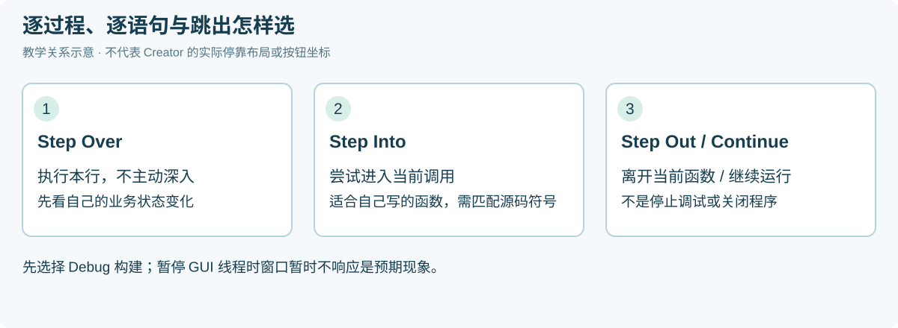

# 65 · Qt Creator 调试操作：断点、变量、调用栈和条件

## 一、先确认调试环境，而不是只点虫子按钮

在 Kit 中检查 Debugger。Windows 上 MSVC 工具链使用 CDB，MinGW 通常使用对应 GDB；不要给当前 MSVC 工程随意混入另一套调试器。安装了 MSVC 或 Windows SDK 的部分组件，不保证 Debugging Tools for Windows 已经安装。

若 Creator 没自动检测 CDB，到 Debuggers/调试器页添加兼容路径，再在课程 Kit 选中它。这里不提供硬编码的 CDB 文件路径，因为本机组件安装位置可能不同；通过已安装工具位置和 Creator 诊断确认实际路径。

切换 Debug 构建配置，重新构建 ProfileWidget。Release 优化可能使变量被优化、单步跳行或断点位置变化，第一次练习不要在优化构建里猜测这些现象。

## 二、放一个必定会经过的断点

1. 打开 ProfileWidget.cpp，在槽函数中读取 name 的下一条语句设置断点，例如 if(name.isEmpty()) 所在行。
2. 在编辑器行号边栏点击，确认出现断点标记；不是点击代码后仅把光标移过去。
3. 使用 Start Debugging/开始调试，而不是普通 Run。
4. 窗口出现后输入“小明”，点击生成计划。
5. IDE 应切到调试状态，当前执行行有醒目标记，变量窗口应能查看 name。

程序停在断点时，GUI 线程暂停，窗口暂时不响应是正常的。不要连续点击窗口又认为死锁，也不要靠停止整个 IDE 来恢复；使用 Continue/继续。

## 三、常用调试动作的实际区别

| 动作 | 效果 | 适合什么时候 |
|---|---|---|
| Continue/继续 | 执行到下个断点或结束 | 当前状态已经看清 |
| Step Over/逐过程 | 执行当前语句，不主动进入函数内部 | 看自己槽函数的数据变化 |
| Step Into/逐语句 | 尝试进入当前调用 | 查看自己实现的函数 |
| Step Out/跳出 | 运行到当前函数返回 | 从深层函数回到调用方 |
| Stop/停止调试 | 结束调试会话，可能终止被调试程序 | 本次检查已完成 |

默认 Windows 键位常见 F5、F10、F11，但先通过 Debug 菜单和工具提示确认当前映射。没有 Qt 库源码或符号时，Step Into Qt 内部可能进入汇编或显示找不到源文件；这不代表你的槽函数没工作。

## 四、变量窗口怎么读

Locals/局部变量显示当前作用域数据；Expressions/表达式或监视窗口可添加 name、ui->minutesSpin->value() 等表达式。优先观察无副作用的数据，不在监视求值里调用保存、删除、网络请求等函数。

当前执行行表示“将执行”或具体调试器显示的停止位置，不能仅凭光标断言该行已经执行完。读取 name 后逐过程越过空值判断，观察控制流是否进入错误分支，再继续到结果更新。

## 五、调用栈与条件断点

Call Stack/调用栈说明程序怎样走到当前函数。选择自己维护的源码帧，查看对应局部变量。崩溃时最后一行可能只是使用了更早释放的对象，不能只在崩溃行加 nullptr 掩盖所有权问题。

右键断点打开编辑属性，可按调试器支持设置条件或命中次数。先用简单条件，如循环里的 i==10；表达式必须在该断点的作用域有效。条件错误可能导致断点不命中或诊断失败，记录原条件后恢复普通断点比较。

## 六、故障清单

断点不命中：先看槽是否连接、实际运行 target、Debug 配置和源码是否与 exe 一致。空心或未绑定标记：查构建符号与加载模块。找不到调试器：修 Kit，不能靠反复重建解决。只能看汇编：回到自己的源码断点并检查调试信息。

验收：空输入和有效输入分别停住，能解释 name、分钟值、确认状态和调用栈；调试结束后普通 Run 仍可工作。未在本机配置好 CDB 时，记录为“待完成调试练习”，不能因为构建通过就写成调试验收通过。

参考：[Creator 调试](https://doc.qt.io/qtcreator/creator-debugging.html)、[受支持的调试器](https://doc.qt.io/qtcreator/creator-debugger-engines.html)。

## 配图逐项讲解

真实截图保持原始内容；图旁说明区分“当前默认状态”“课程目标值”和“故障反例”。示意图用于讲解关系，不代表已经完成的本机操作。可通过每幅图下的原图链接放大查看。

### 图 65-1 · 断点停止后，依次读这三个位置

**教学示意图 · 非实机截图**

[打开原图查看细节](../assets/creator/debug-workspace.svg)

- **看哪里**：按图中 1、2、3 的关系理解该功能。
- **怎样操作**：不要把光标位置当作完成记录；只观察无副作用的表达式；选择自己维护的源码帧。
- **结果与检查**：调试面板功能示意，非本机断点截图；本机当前还未检测到 CDB。

### 图 65-2 · 逐过程、逐语句与跳出怎样选

**教学示意图 · 非实机截图**

[打开原图查看细节](../assets/creator/debug-actions.svg)

- **看哪里**：按图中 1、2、3 的关系理解该功能。
- **怎样操作**：先看自己的业务状态变化；适合自己写的函数，需匹配源码符号；不是停止调试或关闭程序。
- **结果与检查**：先选择 Debug 构建；暂停 GUI 线程时窗口暂时不响应是预期现象。

[返回目录](00-目录.md)
