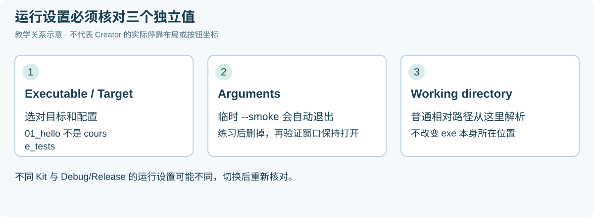
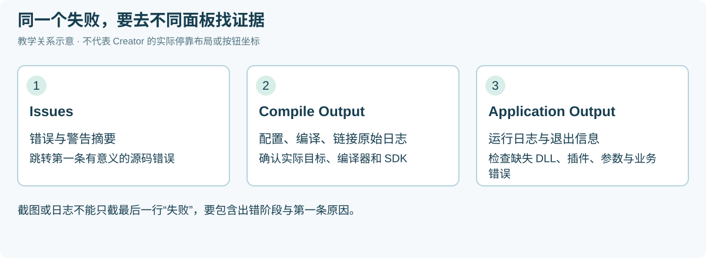

# 66 · Qt Creator 综合操作：运行设置、故障排查与交付

## 一、把运行配置和构建配置分开

Projects/项目中的 Build Settings 控制怎样构建，Run Settings 控制执行哪个程序、参数、工作目录和环境。两个配置都可能随 Kit 与 Debug/Release 改变；在 Debug 下改过的参数，不应假定 Release 一定相同。

本仓库有多个 exe。选择运行目标时确认名称，再核对实际路径。若目标 18_vulkan 没出现，先看是否启用对应 CMake 选项和头文件，不能通过手工把另一个 exe 路径改名来制造目标。

## 二、在界面中填写参数与环境

选择 01_hello 的 Run Settings，在 Arguments/命令行参数中临时填 --smoke，运行后程序应自动退出。清掉参数再运行，应正常保持窗口。这个小实验能证明你修改的是当前运行配置。

如遇 Qt DLL 或插件查找问题，在当前运行配置的 Environment 中添加或前置：

| 变量 | 课程值 | 作用 |
|---|---|---|
| PATH | 在已有值前加入 `E:\QT\QT\sdk\6.8.3\msvc2022_64\bin` | 查找当前 Qt 的 DLL，保留其余环境 |
| QT_PLUGIN_PATH | SDK 根目录下 plugins | 查找 Qt 插件 |
| QT_QPA_PLATFORM_PLUGIN_PATH | SDK 根目录下 plugins/platforms | 平台插件位置 |
| QML_IMPORT_PATH | SDK 根目录下 qml | Quick 的 QML 模块 |

根据实际错误添加必要项，不机械地把全套环境复制给所有项目。普通桌面运行不要遗留 QT_QPA_PLATFORM=offscreen，否则可能没有可交互窗口；图形 API 示例也需要适合的实际显示环境。

Working directory/工作目录影响相对文件路径。修改它不会把 exe 移动到该目录；资源路径 `:/...` 与普通相对磁盘路径又不同，排查“找不到文件”先确认使用哪一种。

## 三、看对输出面板

Issues 便于跳转错误行，Compile Output 保留完整构建命令，Application Output 显示程序日志。编辑器红线来自代码分析，不总是最新构建结论。先保存、构建，看第一条真实错误，再检查分析器的 Kit 和头文件索引。

| 现象 | 第一步检查 | 不建议的盲目操作 |
|---|---|---|
| 没有可用 Kit | Qt、编译器和设备配置 | 随意切成 MinGW |
| 找不到 Qt6Config.cmake | CMAKE_PREFIX_PATH 的 SDK 根目录 | 把 Creator bin 当 Qt SDK |
| .ui 改了但无效果 | 保存、AUTOUIC、目标与构建目录 | 修改生成的 ui_*.h |
| 点击一次执行两次 | 自动槽与显式连接是否重复 | 不看连接就加计时防抖 |
| 新文件没有编译 | CMake 是否列入正确 target | 只看项目树有没有文件 |
| 程序一闪而过 | 参数是否有 --smoke，输出是否有错误 | 无条件重装 Qt |
| 调试按钮不可用 | CDB、Kit、Debug 配置和目标 | 以为所有 C++ 编译器都自带兼容调试器 |

## 四、CMake 选项的图形化编辑

在 Build Settings 中查找 Initial/Current Configuration 等 CMake 配置表。调整 COURSE_BUILD_OPENGL、COURSE_BUILD_VULKAN 等 bool 项后，执行 Run CMake/重新配置，再构建新增目标。参数值的变化与真实 configure 是否成功要分别检查。

改变编译器、生成器或架构时使用新构建目录，不在旧 CMakeCache 上反复覆盖。首次配置与当前缓存两处值可能不同，检查最终生效值和配置输出，不只看输入框里曾经填过什么。

## 五、交付与 Git 面板的边界

Creator 的 Git 面板可以查看差异、暂存与提交。练习先只查看自己的 .cpp/.h/.ui 修改，不把 Qt SDK、build、个人用户配置或真实数据加入仓库。提交前逐文件审阅，自动生成文件不因为 IDE 显示它就应该提交。

运行按钮执行的是开发构建，不自动生成给别人的完整分发包。交付仍按第 40 章部署依赖并做独立运行检查；本专题不把打开 Git 面板或点 Run 当作已发布到 GitHub。

## 最终实操验收

从关闭 IDE 开始，重新打开练习 CMakeLists，选对 Kit 和 Debug，打开 .ui 改一个展示文字，构建运行，提交空值和有效值，用清空按钮操作；再调试停在自己的槽函数。最后指出 .ui 的设计连接、.cpp 的业务逻辑、构建目录和用户配置分别在哪。

把每一步的实际结果写入学习日志。菜单与面板已按官方文档及本机版本信息编写，具体拖拽、Kit 和 CDB 操作仍需在你的当前工作区逐项完成，不冒充所有 GUI 流程都已自动验证。

参考：[运行配置](https://doc.qt.io/qtcreator/creator-run-settings.html)、[CMake 项目设置](https://doc.qt.io/qtcreator/creator-build-settings-cmake.html)。

## 配图逐项讲解

真实截图保持原始内容；图旁说明区分“当前默认状态”“课程目标值”和“故障反例”。示意图用于讲解关系，不代表已经完成的本机操作。可通过每幅图下的原图链接放大查看。

### 图 66-1 · 运行设置必须核对三个独立值

**教学示意图 · 非实机截图**

[打开原图查看细节](../assets/creator/run-settings.svg)

- **看哪里**：按图中 1、2、3 的关系理解该功能。
- **怎样操作**：01_hello 不是 course_tests；练习后删掉，再验证窗口保持打开；不改变 exe 本身所在位置。
- **结果与检查**：不同 Kit 与 Debug/Release 的运行设置可能不同，切换后重新核对。

### 图 66-2 · 同一个失败，要去不同面板找证据

**教学示意图 · 非实机截图**

[打开原图查看细节](../assets/creator/output-panes.svg)

- **看哪里**：按图中 1、2、3 的关系理解该功能。
- **怎样操作**：跳转第一条有意义的源码错误；确认实际目标、编译器和 SDK；检查缺失 DLL、插件、参数与业务错误。
- **结果与检查**：截图或日志不能只截最后一行“失败”，要包含出错阶段与第一条原因。

[返回目录](00-目录.md)
